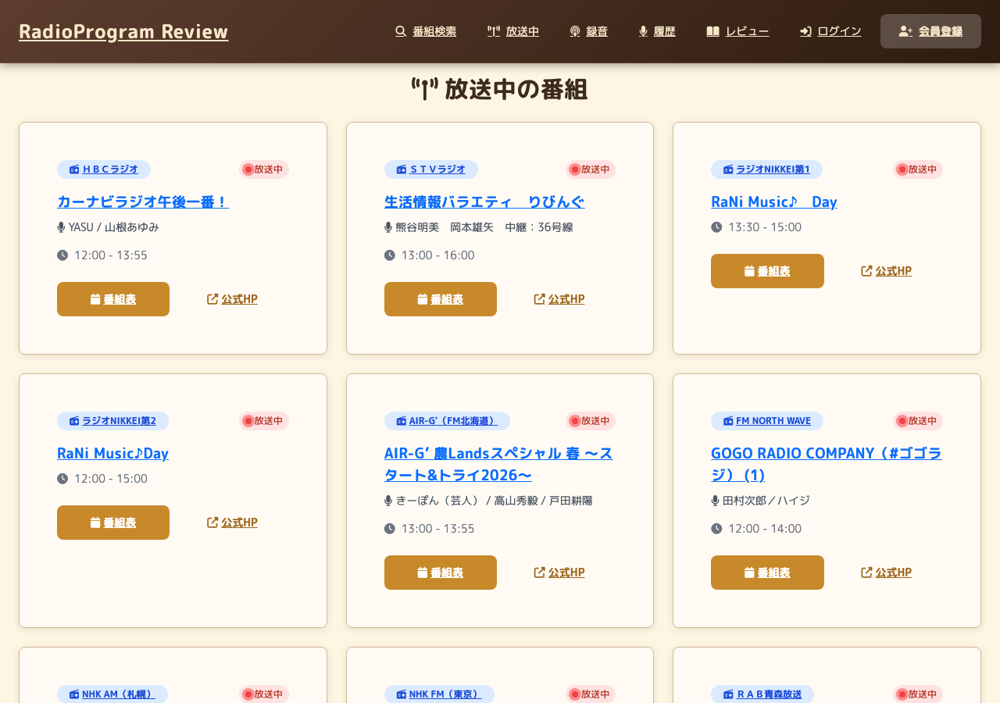
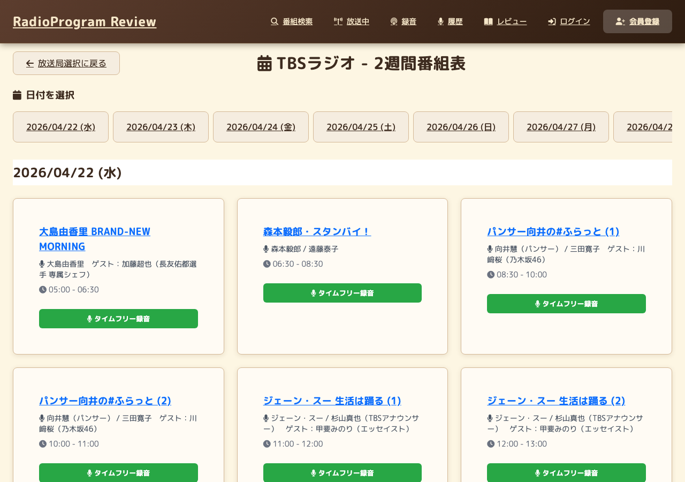

# RadioProgram Review (Go)

Radiko APIと連携するラジオ番組レビューWebアプリケーション。  
PHP/Laravel版（`../radio_review/`）をGoで書き直したもの。

## スクリーンショット

| 放送中の番組 | 2週間番組表（タイムフリー） |
|---|---|
|  |  |

## 主な機能

- 放送中番組の一覧表示（Radiko APIリアルタイム取得）
- 週次・2週間番組表の表示
- 番組詳細・レビュー投稿・レビュー閲覧
- お気に入り番組登録（帯番組の曜日管理対応）
- お気に入り番組の自動録音（起動時・5分ごとに番組表を確認、電源OFF中の取り逃しを回収）
- タイムフリー録音（HLS並列ダウンロード、FFmpegでAAC変換）
- 録音スケジュール管理
- ユーザー認証（登録・ログイン・パスワードリセット）
- PWA対応（Service Worker、オフラインページ）

## 技術スタック

| 領域 | 技術 |
|---|---|
| 言語 | Go 1.22+ |
| ルーター | Chi v5 |
| テンプレート | html/template（標準ライブラリ） |
| DB | MySQL 8.0 + sqlx |
| キャッシュ/セッション | Redis + go-redis |
| 認証 | gorilla/sessions + bcrypt |
| 音声処理 | FFmpeg（os/exec） |
| 設定 | godotenv |
| インフラ | Docker / Docker Compose |

## ディレクトリ構成

```
radio_review_go/
├── cmd/
│   ├── server/main.go      # エントリポイント・ルーティング
│   └── batch/main.go       # バッチ処理
├── internal/
│   ├── handler/            # HTTPハンドラー
│   ├── service/            # ビジネスロジック
│   ├── repository/         # DB操作
│   ├── middleware/         # 認証・CSP・レートリミット
│   ├── job/                # 非同期ジョブ（録音など）
│   └── model/              # 構造体定義
├── pkg/
│   └── radiko/
│       ├── client.go       # Radiko認証・API
│       └── hls.go          # HLSセグメント並列ダウンロード
├── web/
│   ├── templates/          # html/templateファイル
│   └── static/             # CSS・JS・PWAアイコン・SW
├── migrations/             # MySQLスキーマ（Docker起動時に自動適用）
├── docker/
│   └── mysql/my.cnf
├── docker-compose.yml
└── Dockerfile
```

## セットアップ

### Docker（推奨）

```bash
# .envを作成
cp .env.example .env

# Radiko認証キーを配置（タイムフリー録音に必須・下記「Radiko認証キー」参照）
# storage/keys/radiko_auth_key.txt

# 起動（MySQL・Redis・アプリを一括起動）
docker compose up -d

# ブラウザで確認
open http://localhost:8080

# 録音ファイル名リネームバッチ実行
docker compose exec app ./batch rename-recordings ...
```

Windows PowerShell の場合:

```powershell
Copy-Item .env.example .env
New-Item -ItemType Directory -Force storage\keys, storage\recordings
docker compose up -d
Start-Process http://localhost:8080
```

Dockerイメージには `storage/keys/` の認証キーを含めない。Docker利用時は `./storage:/app/storage` のボリュームマウントで参照する。

Docker Compose の MySQL は `./migrations:/docker-entrypoint-initdb.d` により、`db_data` ボリュームの初回作成時のみマイグレーションを適用する。既存の `db_data` ボリュームには後から追加したマイグレーション（005以降）は自動適用されない。既存ボリュームに反映する場合は `docker compose exec -T db mysql -ularavel -ppassword radio_review < migrations/00X.sql` で手動適用するか、データを破棄できる場合のみ `docker compose down -v` 後に再作成する。

### ローカル（Go直実行）

前提: Go 1.22+、MySQL 8.0、Redis、FFmpegがインストール済みであること。

```bash
# 依存関係インストール
go mod download

# DBスキーマ適用（初回のみ）
mysql -u <user> -p <database> < migrations/001_initial.sql
mysql -u <user> -p <database> < migrations/002_add_recurring_to_schedules.sql
mysql -u <user> -p <database> < migrations/003_radio_programs_unique_key.sql
mysql -u <user> -p <database> < migrations/004_push_subscriptions.sql

# .env作成後にサーバー起動
go run cmd/server/main.go
```

## 環境変数（.env）

```env
APP_KEY=<32文字以上のランダム文字列>
APP_ENV=local
APP_PORT=8080
APP_URL=http://localhost:8080

DB_HOST=127.0.0.1
DB_PORT=3306
DB_DATABASE=radio_review
DB_USERNAME=laravel
DB_PASSWORD=password

REDIS_HOST=127.0.0.1
REDIS_PORT=6379
REDIS_PASSWORD=
REDIS_DB=0

RECORDING_STORAGE_PATH=storage/recordings
RECORDING_MAX_PARALLEL=10
RECORDING_RETENTION_DAYS=0

MAIL_MAILER=log
MAIL_HOST=127.0.0.1
MAIL_PORT=1025
MAIL_USERNAME=
MAIL_PASSWORD=
MAIL_FROM=no-reply@example.com
MAIL_FROM_NAME=RadioProgram Review

VAPID_PUBLIC_KEY=
VAPID_PRIVATE_KEY=
VAPID_SUBJECT=mailto:admin@example.com
```

## 開発コマンド

```bash
# 開発サーバー起動
go run cmd/server/main.go

# ビルド
go build -o bin/server cmd/server/main.go

# フォーマット
gofmt -w .

# 静的解析
go vet ./...

# 依存関係整理
go mod tidy
```

## テスト

```bash
# 全テスト実行
go test ./...

# カバレッジ確認
go test -cover ./...

# 特定パッケージ
go test ./internal/handler/...
go test ./pkg/radiko/...

# 特定テスト
go test -run TestRadikoAuth ./pkg/radiko/
```

### カバレッジ

| パッケージ | カバレッジ |
|---|---|
| internal/handler | 78.7% |
| internal/middleware | 86.7% |
| internal/service | 90.1% |
| pkg/radiko | 82.6% |

テンプレートのパース・実行エラーは `TestTemplateSmoke_*` 系テストで検知する。

## コミット前検証（pre-commit hook）

CIと同一の検証をコミット時に強制する pre-commit hook を用意している。クローン後、各環境で一度だけ有効化すること（`core.hooksPath` はローカル設定のため共有されない）。

```bash
git config core.hooksPath .githooks
```

有効化後、`git commit` のたびに `.githooks/pre-commit` が以下を自動実行し、1件でも失敗するとコミットが拒否される。

- `gofmt -l .`（未整形チェック）
- `go vet ./...`
- `golangci-lint v1.64.8`（`go run github.com/golangci/golangci-lint/cmd/golangci-lint@v1.64.8 run ./...`）
- `go test ./... -count=1`

CI（`.github/workflows/ci.yml`）も同一バージョンの golangci-lint を実行する。ローカル検証項目とCI検証項目を一致させ、「ローカルで検知できずCIでのみ落ちる」事故を防ぐ目的。

## アーキテクチャ補足

### Radiko認証
- `pkg/radiko/client.go` で実装
- 認証トークンはRedisに55分キャッシュ（`radiko_auth_token_{areaId}`）
- SSL検証は `InsecureSkipVerify: true`（Radiko API互換性のため意図的）

### Radiko認証キー（タイムフリー録音に必須）
- パス: `storage/keys/radiko_auth_key.txt`
- 内容: Radikoスマートフォンアプリの認証フルキー（バイナリ）を **Base64エンコードした文字列**
- `.gitignore` 対象のためリポジトリには含まれない。各環境で手動配置が必要
- 認証フロー: `auth1` で取得した `keyOffset`/`keyLength` でこのキーから部分キーを抽出し `auth2` に送信
- 鍵が未配置・不正な場合、タイムフリー録音は認証エラー（auth2が401等）で失敗する
- Docker利用時は `storage/keys/` がコンテナにコピー（またはマウント）されること

### HLS並列ダウンロード
- `pkg/radiko/hls.go` で実装
- `errgroup` + `semaphore` で最大N並列（`RECORDING_MAX_PARALLEL` で変更可）
- `RECORDING_RETENTION_DAYS` が正の整数の場合、保持期間を超過した録音ファイルとRedisメタを削除

### 録音アクセス制御
- 録音情報はRedisに `owner_key`（`session_{id}` or `user_{id}`）付きで保存
- 一覧・履歴は自分の `owner_key` と一致するものだけ返す

### お気に入りの自動録音とPC停止中の扱い

- お気に入り登録だけで自動録音する。曜日指定がある場合はその曜日のみ対象。登録前に終了した放送は対象外。
- 起動時と5分ごとに番組表を確認し、放送終了から5分以上経過した放送を録音予約へ追加する。将来の放送時刻を固定する予約は作らず、終了済みの番組表にある実際の日時を使用する。追加した予約の録音処理は毎分実行する。
- 取り逃しの回収時を含め、予約録音の同時ダウンロードは最大2件とする。
- PCの電源OFF・スリープ・アプリ停止中は動作しない。次回起動時に過去7日以内の未録音放送を回収する。スリープ復帰後は次の定期確認で回収する。
- 録音途中でアプリが強制終了した場合、起動時に未完了の自動録音を予約中へ戻し、放送全体を再取得する。稼働中にDB更新が失敗して未完了のまま残った予約も5分ごとの確認で回収する。現在ダウンロード中の予約は復旧対象から除く。Redisの起動遅延時は中断した録音IDを維持し、復旧処理を再試行する。通信失敗や配信遅延は1分・5分・15分・30分・以降1時間の間隔で取得期限まで再試行する（手動予約は従来どおり最大3回）。
- 同じユーザー・放送局・放送開始日時の自動録音はDBの一意キーで重複を防ぐ。完了・失敗・キャンセル済みの自動予約を再走査で作り直さない。
- お気に入り削除後、未開始の自動予約をキャンセルする。録音開始時にも登録状況を確認する。録音中の処理は完了まで継続する。
- 取得期限を過ぎた未完了予約は「期限切れ」として表示し、通知する。停止中に初めて放送され、起動時点ですでに番組表の取得範囲から消えている放送は検出・回収できない。
- 自動録音の予約・結果は `/recording/schedules`、音声は `/recording/history` で確認する。
- 予約録音のRedisメタデータは無期限で保存する。自動録音の完了情報はDBにも保存し、起動時と5分ごとの確認で音声ファイルの存在を確認して一覧を再構築する。孤児ファイルの清掃もDBの完了情報を参照し、Redis消失だけで音声を削除しない。DBを確認できない間は清掃を中止する。手動削除済みのファイルは復活させない。音声の削除は手動削除、または `RECORDING_RETENTION_DAYS` に従う（`0` は保持期限なし）。
- デスクトップ用途として、一つのDBに対してアプリを一つ起動すること。中断復旧処理は複数インスタンスによる同時実行を想定しない。
- PCへのログイン時にアプリ（Docker利用時はDockerとコンテナ）を自動起動するよう設定すると、起動後の回収を自動化できる。WindowsのDocker Desktop環境では下記の設定スクリプトを利用できる。

追加した `008_favorite_auto_recordings.sql` はアプリ起動時のマイグレーションで適用される。Dockerを使う場合は `docker compose up -d --build` で更新する。DBのボリュームと `storage/` を維持すること。

### Windowsログオン時の自動起動（Docker Desktop）

先に通常のセットアップと `docker compose up -d --build` を一度実行し、アプリが動作することを確認する。Docker Desktopの初回設定も完了させておく。

リポジトリ直下で通常権限のWindows PowerShellから実行する:

```powershell
powershell.exe -NoProfile -ExecutionPolicy RemoteSigned -File .\scripts\install-autostart.ps1 -StartNow
```

現在のユーザーのログオン時に `RadioReviewGo` タスクを実行する。Dockerが停止している場合は標準インストール先のDocker Desktopを起動し、最大3分待ってからコンテナを起動する。ログオン時の処理ではビルドを実行しない。起動失敗は1分間隔で最大3回再試行する。ログは `%LOCALAPPDATA%\RadioReviewGo\startup.log` に保存する。

状態確認・解除:

```powershell
Get-ScheduledTaskInfo -TaskName RadioReviewGo
Unregister-ScheduledTask -TaskName RadioReviewGo -Confirm:$false
```

スクリプトの実行前にタスクは作成されない。PCの電源OFF中やWindowsへのログオン前は動作しない。更新後は `docker compose up -d --build` を実行する。リポジトリの配置場所を移動した場合は設定スクリプトを再実行する。

### Web Push
- `VAPID_PUBLIC_KEY`、`VAPID_PRIVATE_KEY`、`VAPID_SUBJECT` が全て設定されている場合のみ有効
- 未設定時は購読APIを無効化し、アプリ内通知DBの作成は継続
- 鍵ペア生成例:

```bash
go run github.com/SherClockHolmes/webpush-go@v1.4.0
```

- 出力された公開鍵・秘密鍵を `.env` に設定する
- `VAPID_SUBJECT` は `mailto:admin@example.com` 形式、またはサイトURLを指定する

### 監視
- `/healthz`: DB/Redis ping
- `/metrics`: Prometheus形式のHTTP・録音ジョブメトリクス
